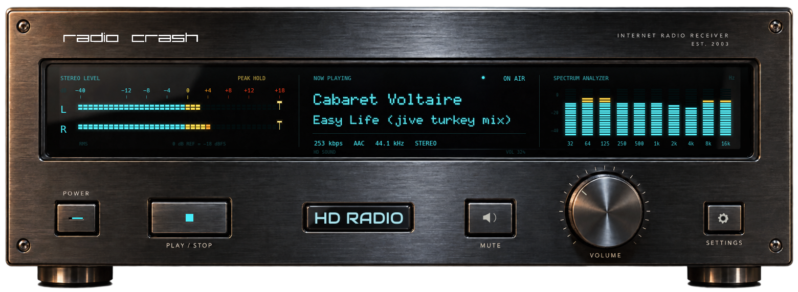

# Radio Crash Desktop

Native Rust internet radio receiver for macOS and Windows, with a photographic black brushed-aluminium fascia and live cyan VFD instruments. eframe/egui paints all live display content and interactive control states. CPAL drives CoreAudio/WASAPI; Symphonia decodes AAC-LC and MP3. No webview, browser engine or external decoder executable is bundled.

Version **1.0.0**. See [release notes](RELEASE-NOTES.md), [Mac installation](INSTALL-macOS.md) and [Windows installation](INSTALL-Windows.md). Official repository: [bandarko/radio-crash-desktop](https://github.com/bandarko/radio-crash-desktop).



## Everyday use and window size

The default is **780 × 286 logical desktop points**, substantially smaller than the original 1200 × 440 layout. The last window size is saved automatically and restored at launch.

- Move: drag the upper chassis.
- Resize: drag the right edge, bottom edge or lower-right corner.
- Exact size: SETTINGS → Window size → Width / Height → Save and apply.
- Presets: Small (640), Everyday (780), Large (1000), Full (1200). Also available from the upper-chassis right-click menu.
- Keep receiver proportions preserves the physical aspect ratio. Disable it to choose width and height independently; the front panel fits proportionally inside the chosen window and is never stretched or scrolled.
- Width range is 560–1920 points; custom unlocked height is 206–1080 points. Detail text is naturally smaller at the smallest sizes. macOS Retina screenshots have twice as many pixels as the window's logical point dimensions.

POWER switches streaming off/on. PLAY / STOP controls the continuous station. Drag or scroll over VOLUME; double-click the knob to mute. MUTE also toggles mute. The live volume value is available in the display and knob tooltip. A size-only settings change does not interrupt audio. Connection URL, metadata URL and device changes restart a playing connection.

Playback continues while minimized. Right-click the upper chassis → **Minimize to tray · L/R meters** hides the receiver and leaves two animated, PCM-driven L/R meters in the macOS menu bar or Windows notification area. Left-click the meters to restore; right-click for Show Radio Crash / Quit Radio Crash. On macOS, tray-only mode also removes the Dock icon and restores it with the receiver. The optional Settings → Minimize to tray preference applies this behavior to Cmd+M / Ctrl+M and ordinary minimization; otherwise normal Dock/taskbar minimization remains available.

Tray painting runs from `App::logic`, not the main window's paint callback, so meters continue while the receiver is hidden or occluded. The image upload loop caps requests near 30 Hz, skips identical images and follows actual platform background scheduling. A native Mac test observed 49 changed icon uploads during six seconds of hidden playback. The icon uses horizontal L/R rows on macOS and two vertical L/R bars in the square Windows notification icon. Both use the same independent pre-volume RMS and DSP peak-hold data as the receiver. The upper-chassis context menu also provides Settings, Minimize and Quit. Settings include autoplay, start minimized, device selection, VU decay, spectrum visibility and quality-badge threshold. Only one skin, VFD Digital — Black Aluminium, is implemented.

## Display and material rendering

The source fascia is an original generated photographic asset with blank, unlit glass and physical control surfaces. Its cutout alpha and the native transparent root window leave the desktop visible around the chassis and feet. The upper-left wordmark uses only the original white station letterforms from the owner-supplied PNG, at a small discreet size directly on the aluminium; the antenna, tagline and black backing are excluded. Metal grain, machining, edge reflections, glass gasket, recessed caps, feet and volume knob are embedded in the app. See [UI-ASSETS.md](UI-ASSETS.md) for the asset, exact generation prompt and tool provenance. The image is uploaded once as two lossless texture tiles; resizing uses the native GPU renderer.

All artists/titles, status, technical properties, VU bars, peak markers, FFT bars and control states are drawn live. No radio measurements or fake animated levels are baked into the image. Phosphor bloom, bright filament cores, dim inactive segments and an optical reflection layer simulate VFD glass. Long track text holds at the beginning for four seconds when metadata changes, then scrolls within its zone.

The stereo scale is **−40 to +18 relative dB**, explicitly calibrated as **0 dB = −18 dBFS**. Digital full scale therefore corresponds to +18 on the relative scale. This display offset does not change audio gain. Lower-range segments have wider numeric gaps; the range around/above zero has 1 dB steps. Cyan is below zero, yellow starts at 0, amber at +4, red at +8. The spectrum is separately labeled in dBFS.

VU RMS and peaks are measured from 256-frame blocks of pre-volume PCM consumed by the audio output. VU attack is immediate; the time-based fall is 120 dB/s (180 in Faster VU decay mode). Independent DSP peak holds retain even sub-frame transients for 1.5 seconds, followed by 12 dB/s decay. Bright gold caps and stems show each held peak, including +18. The FFT uses 4096 samples and 75% overlap (about 43 updates/s at 44.1 kHz), combining channel powers to preserve antiphase stereo. Spectrum attack is immediate with 90 dB/s decay. Active window repaints target 60 FPS; minimized/idle windows repaint less often. Frequency bands at/above Nyquist are unavailable; partial top bands are clipped.

## Radio Crash integration

The existing `RadioCrash-Now-Playing-Discogs-VU/now-playing-discogs-vu.js` in the local `radio-crash-readme-review` checkout was inspected, then the production website/STATS were checked read-only on 2026-10-30.

- Stream: `https://live.radiocrash.net/` (documented STATS `streampath` is `/`; separately fetched and decoded).
- JSON: `https://live.radiocrash.net/stats?json=1&sid=1`.
- Uses `currentsong` or `songtitle`, splitting the first ` - ` and preserving Unicode.
- Polls every 12 seconds during playback, with a three-second deadline; empty endpoint disables polling and failed/missing metadata clears text.
- Independently probed AAC-LC / 44.1 kHz / stereo / about 256 kbps. The app detects codec/rate/channels and measures codec payload bitrate, excluding ADTS framing, so about 254 kbps is expected. It displays unknown values until measured.

HD SOUND is a Radio Crash-defined bitrate-threshold badge, not a standardized codec certification. The physical HD Radio emblem between Play and Mute has a soft cold-white/cyan backlight while powered on, with full illumination when that same threshold is met. Its tooltip explains this custom stream-quality meaning; this application does not decode HD Radio/IBOC broadcasts. The desktop player does not control production broadcasting or SAM/PAL.

## Architecture

- `audio`: cancellable HTTP worker → bounded compressed channel → Symphonia decoder → native-rate or sinc-converted PCM → lock-free one-second queue → CPAL output. Same consumed pre-gain frames feed a separate lock-free analysis tap. The output callback performs no network access, FFT, allocation or mutex acquisition.
- `audio_resample`: native sample rate preferred; fallback is 64-tap, 1024-phase normalized Blackman-windowed sinc with anti-alias filtering. Gain ramps smoothly and output clamps safely. Mono duplicates into stereo; extra device channels receive silence. Sources beyond mono/stereo are rejected.
- `dsp`: independent short-window L/R RMS and sample-clock peak hold, overlapping Hann-window FFT, relative VU reference mapping and time-based display decay.
- `metadata`: documented JSON parsing and Unicode-preserving titles.
- `ui`, `skins`: native controls, live painting over photographic materials, resizing, optional native renderer captures, one skin.
- `settings`: serde JSON in the platform configuration directory, including dimensions and aspect preference; size changes are saved after a brief idle period. Existing configs migrate to compact defaults. Windows file replacement uses a short remove/rename interval.
- `tray_meter`: deterministic RGBA menu-bar/notification-area meter frames with independent stereo channels.
- `platform`: native image uploads, tray click/menu events, Mac Dock activation policy and device discovery. Device names select saved outputs; duplicate names are ambiguous.

HTTP uses reqwest's maintained 0.12 API with a five-second connect deadline and eight-second idle-read deadline, with no total streaming deadline. Reconnect delay is 1, 2, 4, 8, 16, then 32 seconds, reset after a 30-second session. GUI Stop cancels without blocking; final shutdown joins workers. `RUST_LOG=radio_crash_desktop=debug` enables diagnostics.

## Build and release

Install stable Rust from https://rustup.rs and platform tools (Xcode Command Line Tools on macOS; Visual Studio C++ Build Tools/SDK on Windows).

```sh
cargo run --release --locked
cargo test --locked
cargo clippy --locked -- -D warnings
rustup target add aarch64-apple-darwin x86_64-apple-darwin
scripts/package-universal-macos.sh
```

Separate Mac packages: `scripts/package-macos.sh aarch64-apple-darwin` or `scripts/package-macos.sh x86_64-apple-darwin`. Windows MSVC builds on Windows with `cargo build --release --locked --target x86_64-pc-windows-msvc`. For local GNU cross-builds, install MinGW-w64 plus the `x86_64-pc-windows-gnu` Rust target and run `scripts/package-windows-cross.sh`.

`.github/workflows/build.yml` defines native macOS Apple Silicon, Intel and Windows MSVC CI builds/tests. A Windows x64 GNU `.exe` has also been cross-built locally and its PE format, resources and system-DLL imports inspected. Windows playback and Windows 10/11 compatibility have not been manually verified. CI DSP tests do not prove playback or hardware compatibility. Windows downloads are unsigned unless a release explicitly states otherwise. No credentials or external codec binaries are included.

Mac development bundles default to ad-hoc signing. To produce a public direct-download ZIP, install a Developer ID Application identity in the local Keychain and configure a `notarytool` Keychain profile using Apple's secure credential workflow. Then run:

```sh
export RC_SIGN_IDENTITY='Developer ID Application: Your Name (TEAMID)'
export RC_NOTARY_PROFILE='your-existing-notary-profile'
scripts/release-macos.sh
```

The release script enables hardened runtime, timestamps the signature, submits to Apple, requires Accepted status, staples and validates the ticket, checks Gatekeeper and packages the signed app with release notes, installation instructions and licenses. It stops on any failed signing/notarization gate. Development signing and Developer ID signing are not interchangeable. See [Apple's notarization documentation](https://developer.apple.com/documentation/security/notarizing-macos-software-before-distribution). Store credentials in Keychain, never in this repository or a release ZIP.

Alternatively, `python3 scripts/make-xcode-archive.py /path/to/signed.app /path/to/new.xcarchive` wraps an already Developer ID-signed Rust build for Xcode Organizer → Distribute App → Direct Distribution. This uses the existing Xcode account session instead of a separate command-line notarization profile. Always validate the exported app's signature, stapled ticket and Gatekeeper assessment before assembling the download ZIP. This desktop archive uses `net.radiocrash.desktop` and does not change the mobile app's identifiers, certificates or profiles.

When opened in Organizer, Xcode imports a copy under `~/Library/Developer/Xcode/Archives/`. After notarization succeeds, export from Organizer or run `xcodebuild -exportNotarizedApp` against that Xcode-managed copy, not the original wrapper archive. The shipped 1.0.0 Mac build 101 passed notarization, ticket validation and Gatekeeper assessment.

Dependencies are pinned in Cargo.lock; resolved licenses/notices are in DEPENDENCIES.md, THIRD_PARTY_NOTICES.md and licenses/. Doto, Audiowide and retained Rajdhani/Michroma notices are under assets/. Review distribution-specific codec obligations before public release. API references: [eframe](https://docs.rs/eframe/0.37.0/eframe/), [CPAL](https://docs.rs/cpal/0.18.2/cpal/), [Symphonia](https://docs.rs/symphonia/0.6.1/symphonia/), [reqwest](https://docs.rs/reqwest/0.12.28/reqwest/).

## Verification and development tools

See VERIFICATION.md for runtime evidence and manual release gates. AAC-LC and MP3 are supported; HE-AAC/SBR, HLS, authenticated streams and ICY metadata-block demultiplexing are outside this version. Requests disable ICY blocks; configure a compatible JSON endpoint for track text. A screenshot or a PCM smoke test is not subjective listening approval or native Windows runtime validation.

```sh
cargo run -- --smoke 20
python3 scripts/test-reconnect.py /path/to/short.aac
cargo run --release -- --autoplay --window-size 780x286 --capture /absolute/path/receiver.png
```

The optional native capture exports real rendered pixels after four seconds. `--window-size` overrides startup dimensions; normal window persistence then applies. `RC_STREAM_URL` overrides only smoke-test streaming. Smoke playback uses the actual device at 10% gain and joins workers on exit. Mouse drag/scroll and intended hardware/listening quality still require manual user evaluation where native automation is unavailable.

The HD RADIO emblem uses the stylized Audiowide face with its SIL OFL notice in assets/Audiowide-OFL.txt. It retains the cold-white/cyan backlight and the configured quality-threshold highlight.

Optional native tray lifecycle QA (uses the actual station/device; hides at 2 seconds, records live tray output at 8 seconds, restores, and quits at 12 seconds):

```sh
cargo run --release -- --autoplay --tray-check /absolute/path/to/qa-dir
```

The resulting tray-check.json includes hidden logic ticks, changed native icon uploads, actual stereo RMS, playback status and the native Mac tray-only activation policy.
